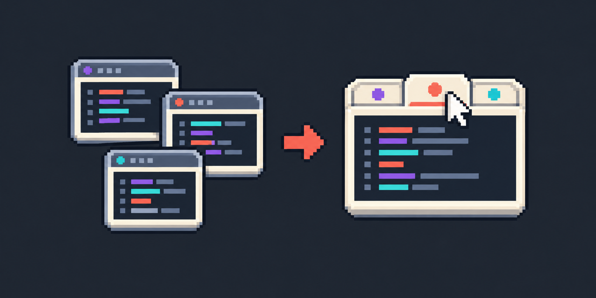

<p align="center">
  
</p>

# Window Tabs

Plugin para PhpStorm e GoLand (e qualquer IDE JetBrains 2026.1+) que mostra os projetos abertos como abas no topo de
cada janela, imitando as abas nativas do macOS no Linux.

- Clique numa aba: a janela daquele projeto assume a posição e o tamanho da atual (ou fica maximizada, se a atual
  estiver) e vem para a frente.
- Clique do meio ou o `×` (aparece no hover): fecha o projeto.
- `+` à direita: abre outro projeto.
- A faixa só aparece com dois ou mais projetos abertos.

Cada projeto continua sendo uma janela própria; o plugin só faz a troca parecer uma aba.

## Build

O Gradle baixa o IntelliJ IDEA 2026.1.5 (a versão mais antiga suportada) e compila e testa contra ele. Roda com
qualquer JDK 21+; em máquina sem JDK, use o JBR do próprio IDE:

```bash
# macOS
export JAVA_HOME=/Applications/PhpStorm.app/Contents/jbr/Contents/Home
# Linux (Toolbox)
export JAVA_HOME=~/.local/share/JetBrains/Toolbox/apps/phpstorm-light/jbr
```

```bash
./gradlew buildPlugin
```

O zip sai em `build/distributions/window-tabs-<versão>.zip`.

## Qualidade

```bash
./gradlew check
```

Roda tudo que o CI exige:

- **ktlint**: estilo oficial do Kotlin (`./gradlew ktlintFormat` corrige sozinho).
- **detekt**: análise estática, regras padrão mais `config/detekt.yml`.
- **Compilador**: qualquer aviso vira erro.
- **Testes**: unidade e de plataforma (um IDE leve sem tela, com projetos reais abertos e fechados).
- **Kover**: cobertura de 100% das linhas e dos branches do plugin inteiro; abaixo disso, falha.

Compatibilidade com PhpStorm e GoLand (`verifyIdeVersion` em `gradle.properties`; baixa os dois IDEs):

```bash
./gradlew verifyPlugin
```

## CI

`.gitlab-ci.yml`: `ktlint` e `detekt`, depois `test` (com cobertura no MR) e `verify`, e por fim `build`, que guarda o
zip como artifact.

## Instalação

Settings → Plugins → ⚙ → Install Plugin from Disk… → escolher o zip. Não precisa reiniciar.

## Linux / GNOME

- No Wayland, o GNOME pode recusar trazer a janela para a frente e mostrar só o aviso "PhpStorm is ready". Se
  acontecer, rodar o IDE em X11: Help → Edit Custom VM Options → `-Dawt.toolkit.name=XToolkit`.
- Mantenha as janelas maximizadas: a troca fica instantânea e sem salto de posição.
- Alt+Tab do GNOME continua listando uma janela por projeto. Para escondê-las do Alt+Tab, use a extensão "Alternate
  Tab" ou troque o atalho para "Switch windows of an application" (Super+`).

## Limitação

A faixa usa o extension point `ideRootPaneNorth`, marcado como interno pela JetBrains. O `verifyPlugin` aceita
(só falha por incompatibilidade real), mas uma versão futura da IDE pode mudar essa API.

## Repositório

O código vive em [gitlab.com/danie1net0/window-tabs](https://gitlab.com/danie1net0/window-tabs).
[github.com/danie1net0/window-tabs](https://github.com/danie1net0/window-tabs) é um espelho somente leitura,
copiado do GitLab a cada 6 horas pelo workflow `.github/workflows/mirror.yml` (ou na hora, pela aba Actions).

