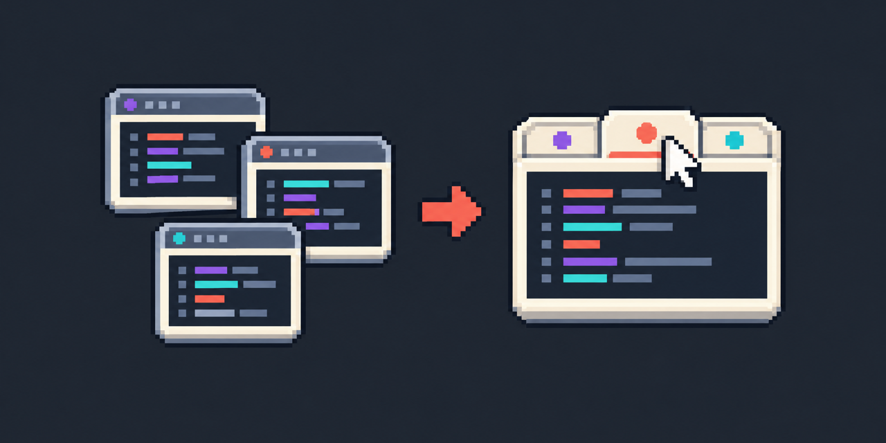
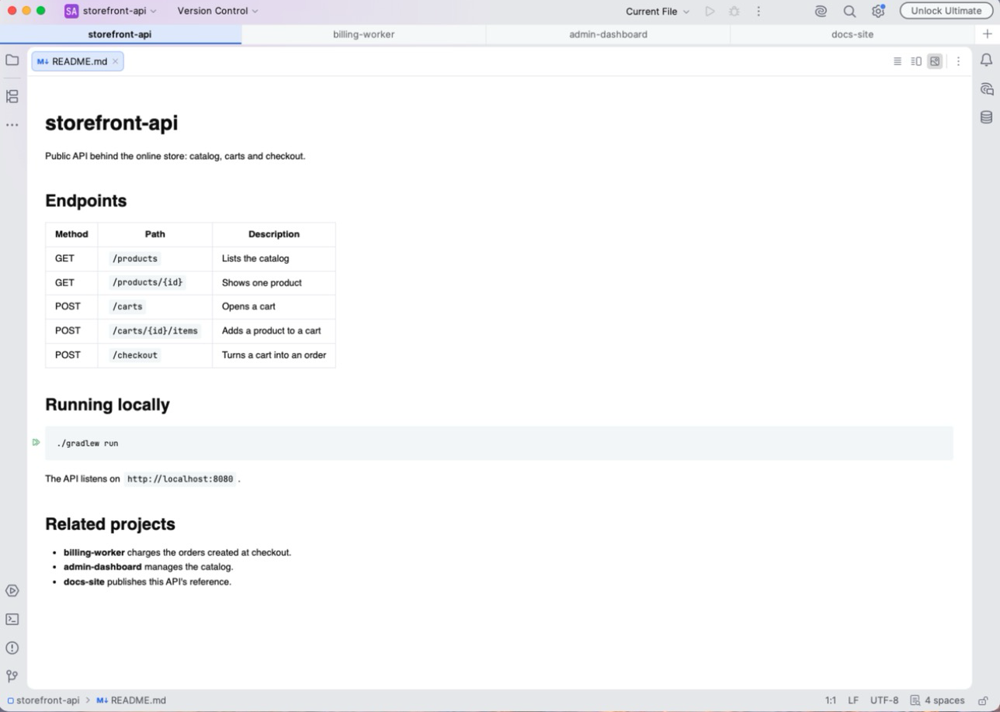

<div align="center">



<br>

<p>
  
  
  <a href="https://gitlab.com/danie1net0/window-tabs/-/pipelines"></a>
  <a href="https://gitlab.com/danie1net0/window-tabs/-/pipelines"></a>
  <a href="LICENSE"></a>
</p>

<sub><a href="README.md">🇺🇸 English</a> · <b>🇧🇷 Português</b></sub>

</div>

## Por quê

No macOS, os IDEs da JetBrains juntam as janelas de projeto em abas nativas. No Linux esse recurso não existe: cada
projeto abre numa janela própria, e trocar de projeto vira caça no Alt+Tab. O Window Tabs põe uma faixa de abas no topo
de cada janela de IDE JetBrains (2024.3 ou mais novo, Android Studio incluído), uma aba por projeto aberto.

- **Clique numa aba**: a janela daquele projeto assume o tamanho e a posição da atual (ou fica maximizada, se a atual
  estiver) e vem para a frente.
- **Clique do meio ou `×`** (aparece no hover): fecha o projeto.
- **`+`** à direita: abre outro projeto.
- **Arraste uma aba** para mudar a ordem; a ordem continua depois de reiniciar.
- **Alt+Shift+1…9**: vai direto para aquela aba. **Window | Project Tabs** também tem Next e Previous Project Tab, sem
  atalho padrão (defina um em Settings | Keymap).
- Cada aba mostra o ícone do projeto. Com muitos projetos abertos, as abas mantêm uma largura legível e a faixa rola com
  a roda do mouse.
- A faixa só aparece com dois ou mais projetos abertos.

**Settings | Appearance & Behavior | Window Tabs** mostra a faixa mesmo com um projeto só, esconde os ícones e liga a
faixa no macOS, onde ela começa desligada porque o IDE já junta as janelas em abas nativas.

Cada projeto continua sendo uma janela própria; o plugin só faz a troca parecer uma aba.

<p align="center">
  
</p>

## Instalação

Baixe `window-tabs-<versão>.zip` dos artifacts do último
[job `build`](https://gitlab.com/danie1net0/window-tabs/-/pipelines), ou gere o zip (abaixo). No IDE:
**Settings → Plugins → ⚙ → Install Plugin from Disk…** e escolha o zip. Não precisa reiniciar.

## Linux / GNOME

- No Wayland, o GNOME pode recusar trazer a janela para a frente e mostrar só o aviso "PhpStorm is ready". Se
  acontecer, rode o IDE em X11: **Help → Edit Custom VM Options** → `-Dawt.toolkit.name=XToolkit`.
- Deixe as janelas maximizadas: a troca fica instantânea e sem salto de posição.
- O Alt+Tab do GNOME continua listando uma janela por projeto. O Super+` (*Switch windows of an application*) também
  alterna entre elas.

## Build

O Gradle baixa o IntelliJ IDEA 2024.3.6, a plataforma mais antiga suportada, e compila e testa contra ele. Qualquer
JDK 21+ roda o build; em máquina sem JDK, aponte o `JAVA_HOME` para o JBR do próprio IDE:

```bash
# macOS
export JAVA_HOME=/Applications/PhpStorm.app/Contents/jbr/Contents/Home
# Linux (Toolbox)
export JAVA_HOME=~/.local/share/JetBrains/Toolbox/apps/phpstorm/jbr
```

```bash
./gradlew buildPlugin
```

O zip sai em `build/distributions/`.

## Qualidade

```bash
./gradlew check
```

Roda tudo que o CI exige:

- **ktlint**: estilo oficial do Kotlin (`./gradlew ktlintFormat` corrige sozinho).
- **detekt**: análise estática, regras padrão mais `config/detekt.yml`.
- **Compilador**: qualquer aviso vira erro.
- **Testes**: de unidade e de plataforma (um IDE sem tela abrindo e fechando projetos reais).
- **Kover**: 100% das linhas e dos branches do plugin cobertos; abaixo disso, o build falha.

Compatibilidade com a plataforma mais antiga e o IDE mais novo de cada família (`verifyIdes` em `gradle.properties`;
baixa vários GB na primeira vez):

```bash
./gradlew verifyPlugin
```

O pipeline do GitLab roda `ktlint` e `detekt`, depois `test` e `verify`, e por fim `build`, que guarda o zip como
artifact. No espelho do GitHub, o workflow `Windows` roda os mesmos testes no Windows.

## Relatórios de erro

Quando o plugin lança uma exceção ou trava o IDE, a janela IDE Internal Errors oferece
**Report to third-party plugin**. O relatório vai para o JetBrains Marketplace, que o mostra nas abas Exceptions e
Freezes do plugin, com o stack trace, o sistema, a versão do IDE e a do plugin. Nada é enviado sem o consentimento do
usuário, a não ser para quem ligou **Send error reports to JetBrains automatically** no IDE.

## Limitação

A faixa usa o extension point `ideRootPaneNorth`, marcado como interno pela JetBrains. O `verifyPlugin` aceita (só
falha por incompatibilidade real), mas uma versão futura do IDE pode mudar essa API.

## Repositório

O código vive em [gitlab.com/danie1net0/window-tabs](https://gitlab.com/danie1net0/window-tabs).
[github.com/danie1net0/window-tabs](https://github.com/danie1net0/window-tabs) é um espelho somente leitura.

## Licença

[MIT](LICENSE)
